# Praktikum Pertemuan 02

## Nama : NEISA PUTRI SYIFAUL QOLBY

## Nim : 255410020

## Kelas : Informatika-1
---

## Bagian 1: Pengelolaan Proses pada Sistem Operasi

### 1. Memeriksa Sistem Operasi dan PowerShell
Memeriksa versi PowerShell dan sistem operasi yang digunakan.
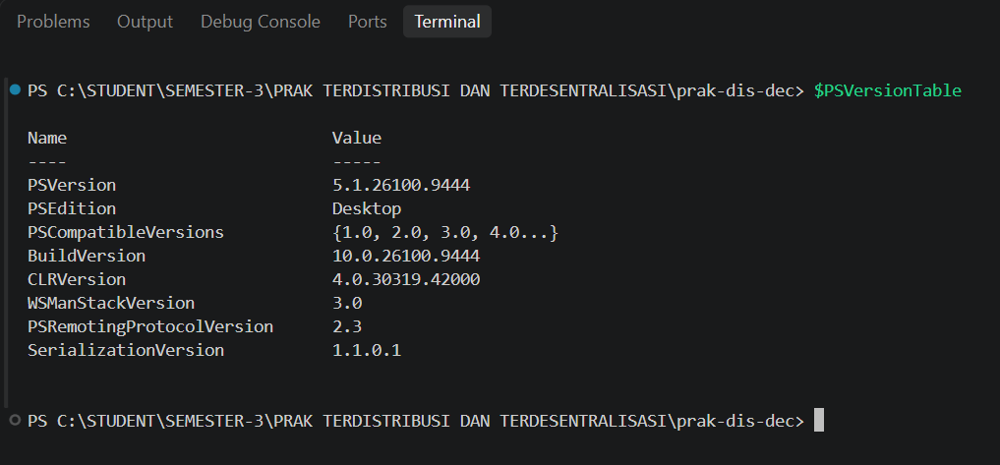

### 2. Menampilkan Proses yang Berjalan
- **Menggunakan Task Manager**:
  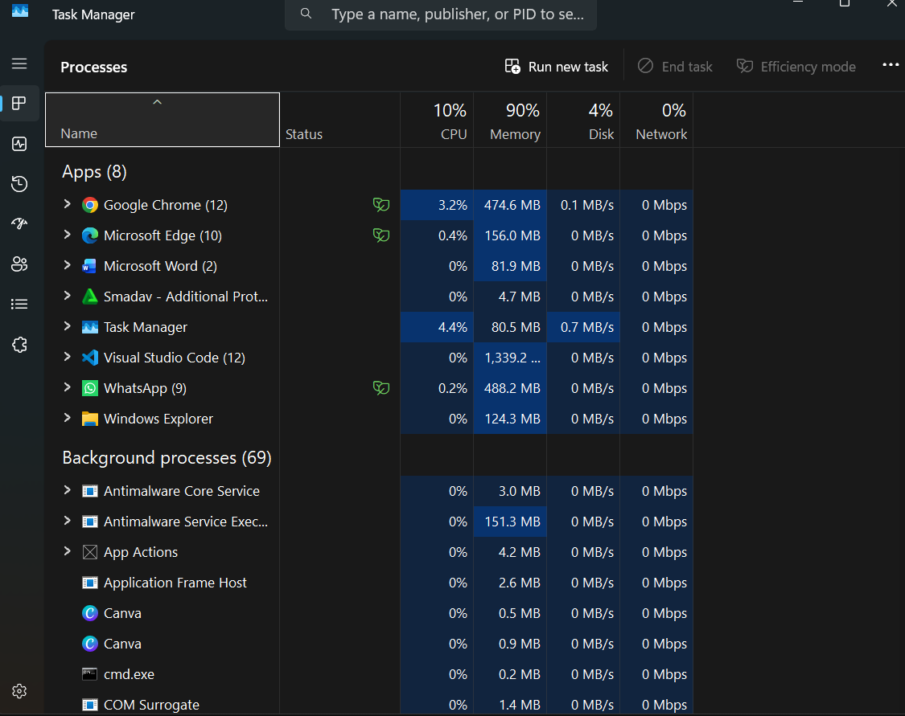

- **Menggunakan PowerShell**:
  Perintah: `Get-Process | Select-Object Id, ProcessName, CPU`
  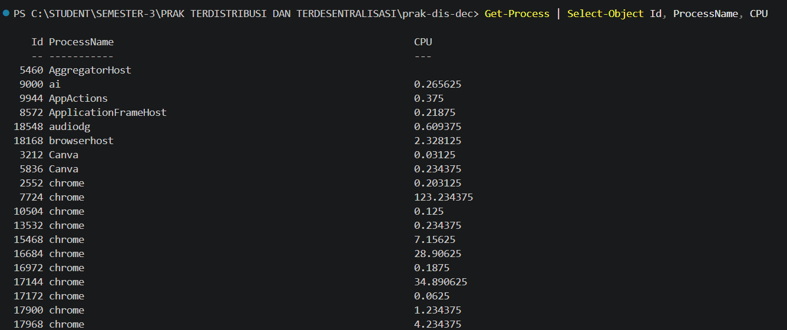

### 3. Menjalankan Aplikasi dan Menemukan PID
Membuka aplikasi untuk mendapatkan identifikasi Process ID (PID).
- **Aplikasi Dijalankan**:
  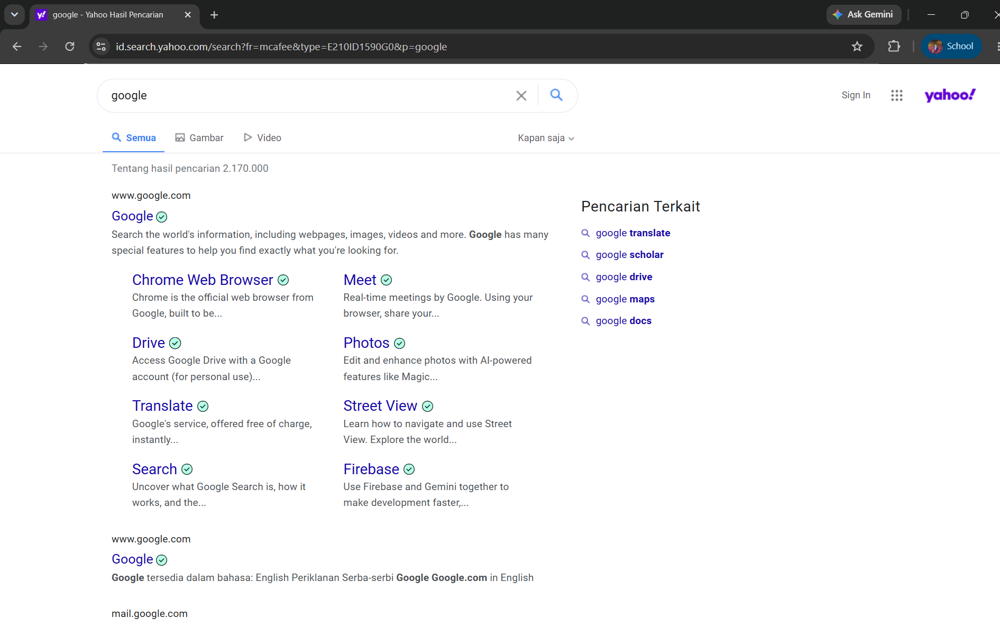

- **Memeriksa PID Aplikasi**:
  Perintah: `Get-Process <nama_aplikasi>`
  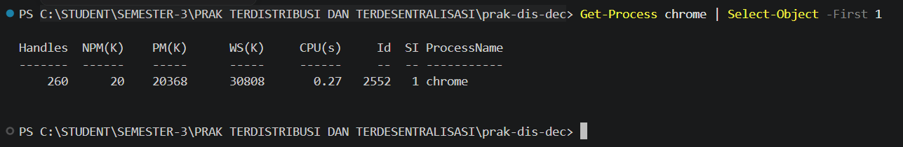

### 4. Menghentikan Proses Menggunakan Command Line
Menghentikan aplikasi langsung dari PowerShell menggunakan PID tanpa menggunakan tombol 'X' pada aplikasi.
- **Stop Process Normal**:
  Perintah: `Stop-Process -Id <PID>`
  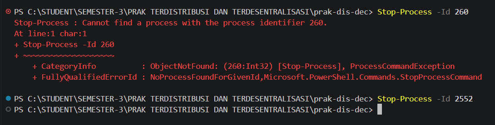

- **Menjalankan Ulang dan Cek PID Baru**:
  Saat aplikasi dijalankan kembali, sistem operasi memberikan PID baru yang berbeda.
  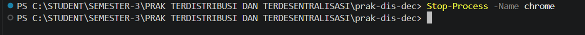

- **Penghentian Paksa (Force Kill)**:
  Perintah: `Stop-Process -Id <PID> -Force`
  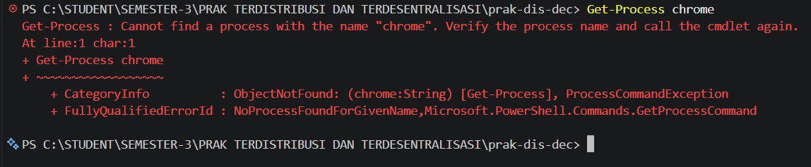

---

## Bagian 2: Implementasi GraphQL Server dan Client

### 1. Persiapan Workspace dan Environment
- **Membuat Workspace `workspace-01`**:
  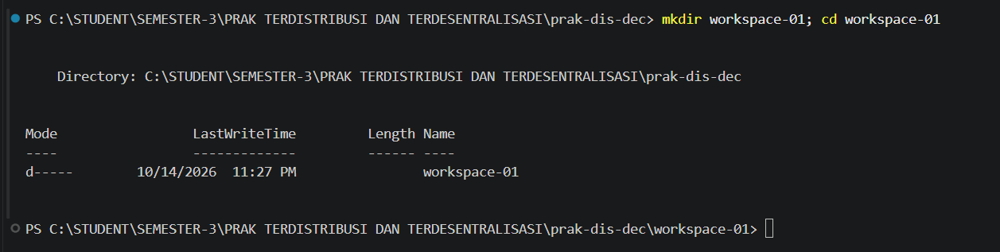

- **Memeriksa Versi `uv`**:
  

- **Instalasi Python 3.14**:
  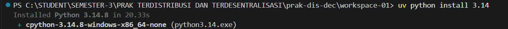

- **Aktivasi Virtual Environment**:
  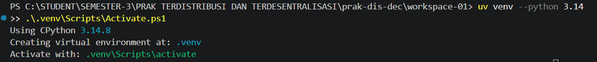

- **Instalasi Paket Strawberry GraphQL & Uvicorn**:
  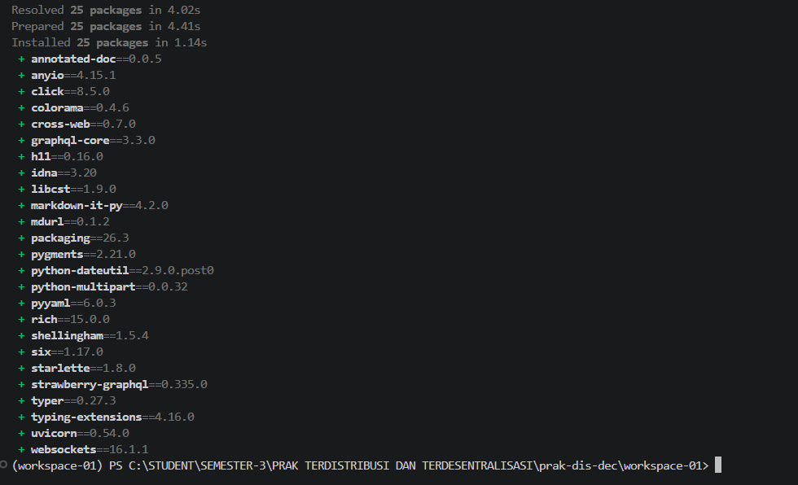

---

### 2. Kode GraphQL Server (`workspace-01/schema.py`)
File `schema.py` berfungsi untuk membangun server GraphQL yang menyediakan data daftar buku.

```python
import strawberry
from strawberry.asgi import GraphQL

@strawberry.type
class Book:
    title: str
    author: str

@strawberry.type
class Query:
    @strawberry.field
    def books(self) -> list[Book]:
        return [
            Book(
                title="Distributed Systems",
                author="Andrew S. Tanenbaum",
            ),
            Book(
                title="The Pragmatic Programmer",
                author="David Thomas",
            ),
        ]

schema = strawberry.Schema(query=Query)
app = GraphQL(schema)
 
```
## Pengujian Server GraphQL

1. Menjalankan server Strawberry dengan Uvicorn:

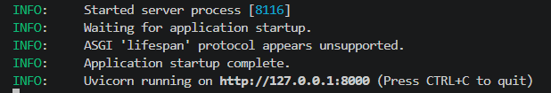

2. Pengujian Query `books` di GraphQL Playground Browser:

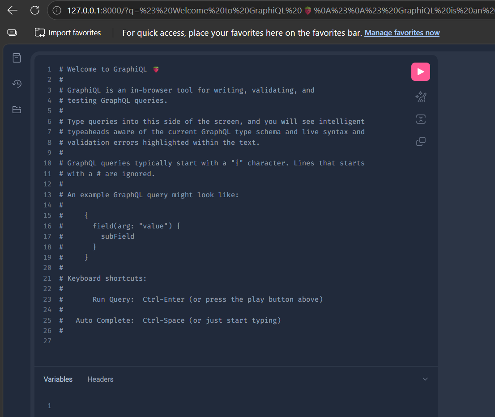


<p align="center">

**Praktikum Pert 2 — Git dan GitHub**

*Sistem Terdistribusi dan Terdesentralisasi*

</p>