# Praktikum Pertemuan 03

## Nama : NEISA PUTRI SYIFAUL QOLBY

## Nim : 255410020

## Kelas : Informatika-1

---

### Sinkronisasi pada Sistem Terdistribusi

 Laporan Praktikum Sistem Terdistribusi dan Terdesentralisasi mengenai Sinkronisasi Waktu (NTP), Vector Clock, Problem Tanpa Sinkronisasi (Multithreading, Race Condition, Deadlock), serta Algoritma Consensual Raft.

---

## 3.1 Sinkronisasi Waktu (NTP)

Sinkronisasi waktu di sistem terdistribusi menggunakan aplikasi **NetTime** di lingkungan Windows.

1. **Pengujian dan Sinkronisasi Waktu dengan NetTime:**
   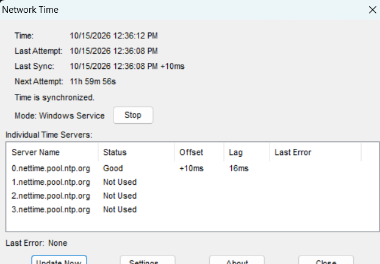

2. **Penjelasan Proses Sinkronisasi:**
   * Aplikasi NetTime bertindak sebagai NTP Client yang mengirimkan paket request UDP (Port 123) ke NTP Server eksternal (misal `pool.ntp.org`).
   * NetTime menghitung estimasi keterlambatan jaringan (*round-trip delay*) dan offset waktu lokal.
   * Jam sistem pada laptop disesuaikan secara berangsur (*slewing*) atau langsung (*stepping*) agar waktu lokal sinkron secara presisi dengan server standar NTP.

---

## 3.2 Vector Clock

Vector Clock digunakan untuk menentukan urutan kejadian (*event ordering*) dan kausalitas antar proses dalam sistem terdistribusi tanpa bergantung pada waktu fisik.

1. **Hasil Eksekusi Program `test_vclocks.py`:**
   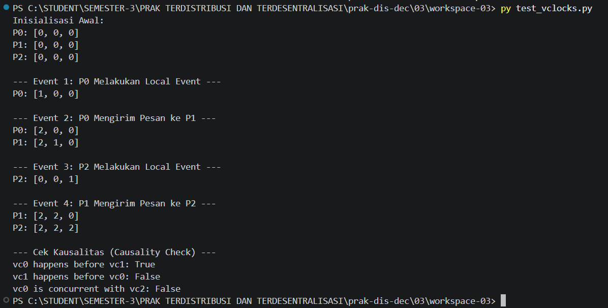

2. **Perbandingan Hasil Algoritma Program vs Manual:**
   * **Inisialisasi Awal:** `P0 = [0, 0, 0]`, `P1 = [0, 0, 0]`, `P2 = [0, 0, 0]`.
   * **Event 1 (Local Event P0):** $P_0$ menambah jam lokalnya $\rightarrow$ `P0 = [1, 0, 0]`.
   * **Event 2 (P0 kirim pesan ke P1):** 
     * $P_0$ increment sebelum kirim $\rightarrow$ `P0 = [2, 0, 0]`.
     * $P_1$ menerima `[2, 0, 0]`, mengambil `max([0,0,0], [2,0,0]) = [2,0,0]`, lalu increment jam lokalnya ($P_1$) $\rightarrow$ `P1 = [2, 1, 0]`.
   * **Event 3 (Local Event P2):** $P_2$ increment jam lokalnya $\rightarrow$ `P2 = [0, 0, 1]`.
   * **Event 4 (P1 kirim pesan ke P2):**
     * $P_1$ increment sebelum kirim $\rightarrow$ `P1 = [2, 2, 0]`.
     * $P_2$ menerima `[2, 2, 0]`, mengambil `max([0,0,1], [2,2,0]) = [2,2,1]`, lalu increment jam lokalnya $\rightarrow$ `P2 = [2, 2, 2]`.
   * **Pemeriksaan Kausalitas:**
     * `vc0 happens before vc1` = **True** (karena setiap elemen $vc0 \le vc1$ dan ada yang strictly less).
     * `vc0 is concurrent with vc2` = **True** (karena tidak ada hubungan kausal langsung antara $vc0$ saat local event awal dengan $vc2$).

---

## 3.3 Problem Tanpa Sinkronisasi

### 3.3.1 Multithreading Example

Pengujian eksekusi thread secara *asynchronous* menggunakan `multithreaded-example.py`.

* **Tampilan Eksekusi 1:**
  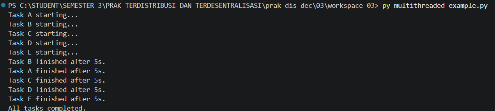

* **Tampilan Eksekusi 2:**
  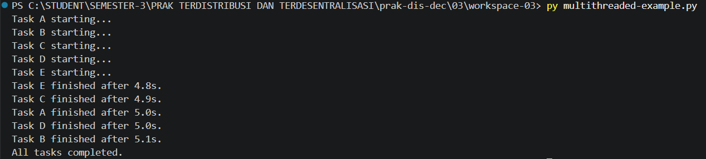

* **Penjelasan Mengapa Output Bisa Berbeda:**
  Penjadwalan thread (*thread scheduling*) diatur penuh oleh *Operating System (OS) Thread Scheduler*. Karena setiap task berjalan secara gabungan (*concurrent/asynchronous*), OS menentukan urutan eksekusi CPU dan konteks switching yang bergantung pada beban sistem saat itu. Sehingga waktu selesai tiap thread tidak dapat diprediksi secara sekuensial.

---

### 3.3.2 Data Race / Race Conditions

1. **Hasil Eksekusi `race-conditions-01.py` (Terjadi Data Race):**
   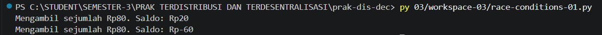

2. **Visualisasi Mengapa Terjadi Race Condition:**
   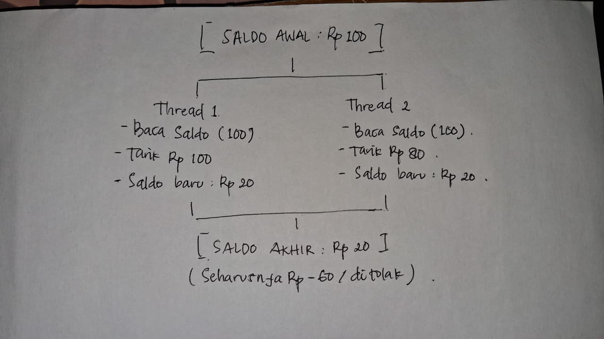

   * **Penjelasan:** Saldo awal `Rp100`. Thread 1 ($T_1$) dan Thread 2 ($T_2$) membaca `balance = 100` secara bersamaan sebelum ada yang menulis ulang. Karena keduanya lolos validasi `balance >= 80`, keduanya mengurangi saldo sebesar `80`. Akibatnya saldo akhir menjadi `Rp20` (atau minus/salah), padahal seharusnya transaksi kedua ditolak karena saldo tidak cukup.

3. **Hasil Eksekusi `race-conditions-02.py` (Pencegahan dengan Lock):**
   

   * **Penjelasan Mengapa Race Condition Tidak Terjadi:**
     Penggunaan `threading.Lock()` menciptakan *critical section*. Ketika $T_1$ memasuki blok `with counter_lock:`, $T_1$ memegang kunci. $T_2$ dipaksa menunggu (*blocked*) sampai $T_1$ selesai mengurangi saldo dan melepaskan kunci. Saat $T_2$ masuk, nilai `balance` sudah bernilai `20`, sehingga kondisi `balance >= 80` bernilai **False** dan transaksi $T_2$ aman dicegah.

---

### 3.3.3 Deadlock

1. **Hasil Eksekusi `deadlock-01.py` (Kondisi Deadlock):**
   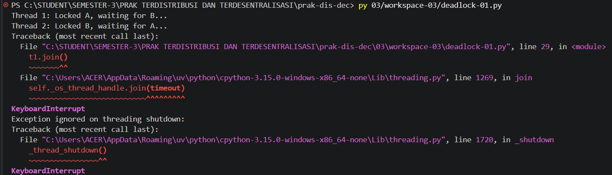

2. **Visualisasi Mengapa Terjadi Deadlock:**
   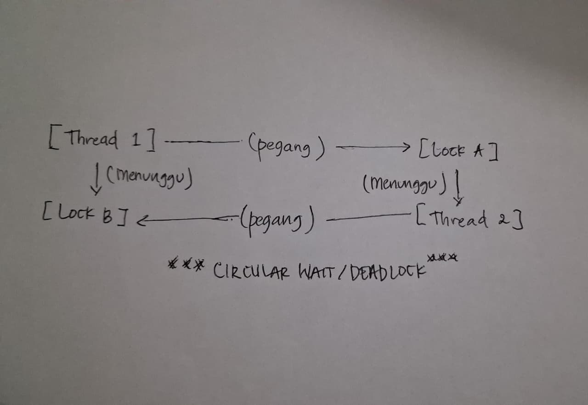

   * **Penjelasan:** Terjadi kondisi *Circular Wait*. Thread 1 memegang `Lock A` dan menunggu `Lock B`. Di saat yang sama, Thread 2 memegang `Lock B` dan menunggu `Lock A`. Kedua thread saling menunggu kunci yang dipegang pihak lain secara tak terbatas sehingga program berhenti/gantung (*hang*).

3. **Hasil Eksekusi `deadlock-02.py` (Pencegahan Deadlock):**
   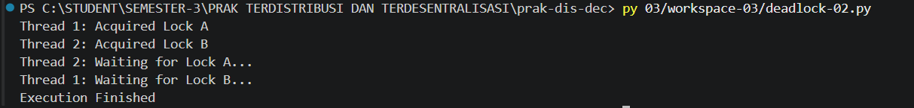

   * **Penjelasan Mengapa Deadlock Tidak Terjadi:**
     Program menggunakan metode `acquire(timeout=5)`. Jika suatu thread tidak berhasil mendapatkan kunci dalam waktu 5 detik, proses tidak akan menunggu selamanya, melainkan membatalkan percobaan dan mengeksekusi blok `finally` untuk melepaskan kunci yang dipegangnya. Ini memutuskan rantai *circular wait*.

---

## 3.4 Algoritma Raft Consensus

1. **Hasil Eksekusi Simulasi `test_raft.py`:**
   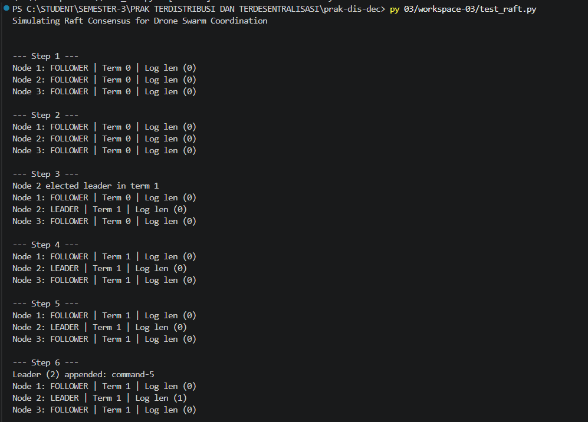

2. **Visualisasi Pemilihan Leader pada Algoritma Raft:**
   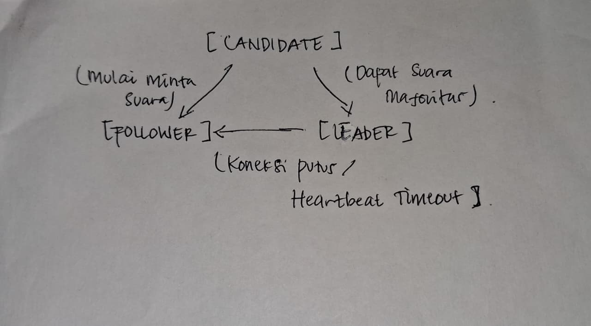

   * **Penjelasan Sederhana Algoritma Raft:**
     * Semua Node bermula sebagai **FOLLOWER**. Jika tidak menerima *heartbeat* dari Leader sebelum *election timeout* habis, Follower berubah status menjadi **CANDIDATE**.
     * Candidate menaikkan nilai `Term`, memilih dirinya sendiri, dan mengirim permintaan suara (*RequestVote*) ke node lain.
     * Jika Candidate memperoleh suara mayoritas ($> N/2$), Candidate resmi terpilih menjadi **LEADER**.
     * Leader lalu mengirimkan sinyal *heartbeat* secara berkala ke semua Follower untuk mempertahankan posisinya dan mencegah *election* baru.

     

**Praktikum Pert 3 — Git dan GitHub**

*Sistem Terdistribusi dan Terdesentralisasi*

