# Praktikum Pertemuan 04

## Nama : NEISA PUTRI SYIFAUL QOLBY

## Nim : 255410020

## Kelas : Informatika-1

---


## Modul 04: Konsistensi dan Replikasi pada Sistem Terdistribusi

Repositori ini berisi file konfigurasi, skrip SQL, serta laporan pengerjaan praktikum **Modul 04** untuk mata kuliah **Sistem Terdistribusi dan Terdesentralisasi**.

Praktikum ini membahas tentang penerapan basis data terdistribusi menggunakan **PostgreSQL Streaming Replication** (Single Primary / Master-Slave) dan **Apache Ignite Cluster** (Master-Master / Multi-Master).


## Struktur Folder
- `images/`: Berisi gambar/screenshot hasil praktikum.
- `streaming-replication/`: Konfigurasi Docker, `00_init.sql`, `docker-compose.yaml`, dan `env.sh` untuk PostgreSQL Streaming Replication.
- `ignite3-cluster/`: Konfigurasi Docker Compose, `env.sh`, serta kumpulan skrip SQL (`sql/`) untuk Apache Ignite 3.

---

## 4.1 Streaming Replication Menggunakan PostgreSQL

Materi ini membahas konfigurasi *streaming replication* pada PostgreSQL 18 (Single-Primary Replication) menggunakan Docker Compose.

### 4.1.1 Prasyarat
1. Docker Engine / Docker Desktop telah terinstal dan aktif (`dockerd`).
2. Docker Compose telah terinstal.
3. Lingkungan terminal (PowerShell / Bash) siap digunakan.

### 4.1.2 Struktur Direktori dan File
File yang digunakan terletak pada folder `streaming-replication/`:
- `00_init.sql`: Skrip SQL untuk membuat user `replicator` dan slot replikasi fisik (`replication_slot`).
- `docker-compose.yaml`: File konfigurasi Docker Compose untuk mengaktifkan dua service container: `postgres_primary` dan `postgres_replica`.
- `env.sh`: Skrip pendukung berisi definisi alias perintah shell.

### 4.1.3 Menjalankan Docker Compose
Jalankan container menggunakan Docker Compose, lalu periksa apakah kedua container (`postgres_primary` dan `postgres_replica`) sudah aktif berstatus `healthy`.

Perintah yang dijalankan:
```powershell
cd streaming-replication
docker compose up -d
docker ps
```

**Hasil Pengecekan Status Container:**
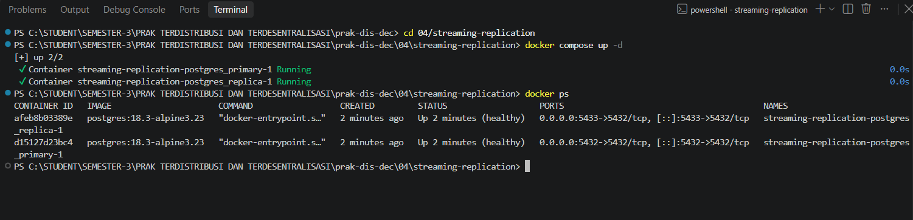

---

### 4.1.4 Pengujian Replikasi

#### A. Pengecekan Diagnostik Replikasi pada Primary Server
Memeriksa tabel diagnostik `pg_stat_replication` dan `pg_replication_slots` pada server primary untuk memastikan proses replikasi sedang aktif (*streaming*).

Perintah yang dijalankan:
```powershell
docker exec -it streaming-replication-postgres_primary-1 psql -U zuser -d zdb
```
Di dalam prompt `zdb=#`:
```sql
\x
SELECT * FROM pg_stat_replication;
SELECT * FROM pg_replication_slots;
\q
```

**Hasil Diagnostik Replikasi Primary:**
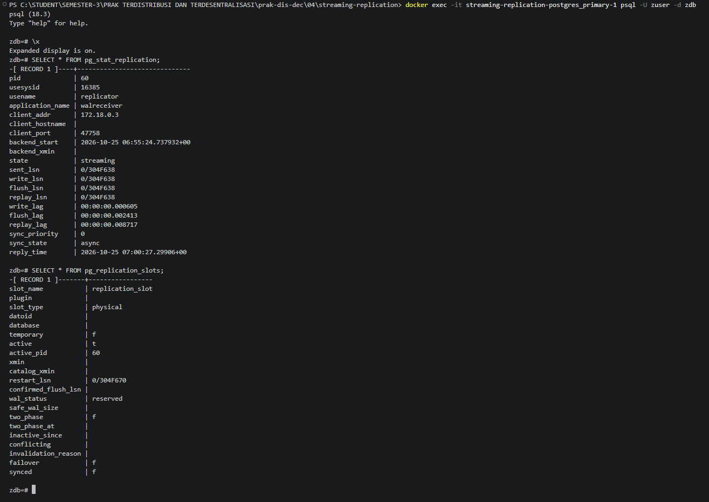

#### B. Pengecekan Status Recovery pada Replica Server
Memeriksa apakah server replica berada dalam kondisi *standby/recovery mode* (`true`).

Perintah yang dijalankan:
```powershell
docker exec -it streaming-replication-postgres_replica-1 psql -U zuser -d zdb
```
Di dalam prompt `zdb=#`:
```sql
SELECT pg_is_in_recovery();
\q
```

**Hasil Status Recovery Replica:**
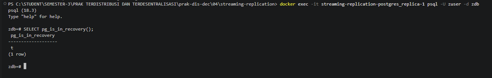

#### C. Manipulasi Data pada Primary dan Sinkronisasi ke Replica
Pengujian pemrosesan data dengan membuat tabel `testrep` dan mengisi baris data pada server primary, kemudian mengecek otomatisasi replikasi data di server replica.

1. **Membuat Tabel dan Input Data pada Primary Server:**
```sql
CREATE TABLE testrep (first INT, second VARCHAR(15));
INSERT INTO testrep (first, second) VALUES (21, 'Test pertama');
INSERT INTO testrep (first, second) VALUES (23, 'Test ke dua');
SELECT * FROM testrep;
```

**Hasil Input Data di Primary:**
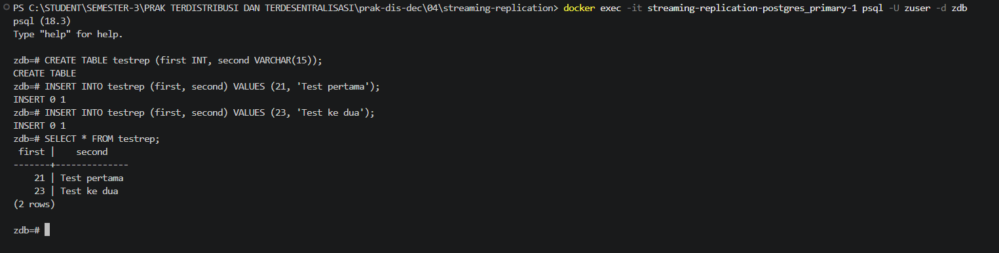

2. **Memeriksa Sinkronisasi Data pada Replica Server:**
```sql
SELECT * FROM testrep;
```

**Hasil Replikasi Data di Replica:**
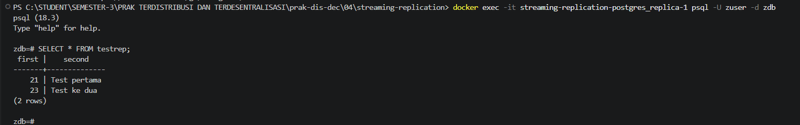

---

### 4.1.5 High-Availability (HA)

Pengujian skenario *failover* ketika Primary Server mengalami penghentian (*down*), sehingga Replica Server dipromosikan menjadi Primary Server baru yang mendukung akses Read-Write.

#### A. Menghentikan Primary Server
Perintah:
```powershell
docker stop streaming-replication-postgres_primary-1
```

#### B. Mempromosikan Replica Server Menjadi Primary Baru
Masuk ke container replica lalu jalankan fungsi `pg_promote()`:
```sql
SELECT pg_is_in_recovery();
SELECT pg_promote();
SELECT pg_is_in_recovery();
```

**Hasil Promosi Replica Menjadi Primary (Status recovery berubah dari true menjadi false):**
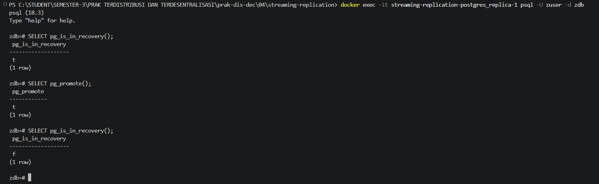

#### C. Menghentikan Seluruh Container PostgreSQL
Perintah:
```powershell
docker compose down
```

---

## 4.2 Replikasi Master-Master Menggunakan Apache Ignite

Materi ini membahas konfigurasi *cluster* pada **Apache Ignite 3 (versi 3.1.0)** menggunakan mode replikasi Master-Master (Multi-Master), di mana setiap *node* bertindak sebagai primary yang dapat melakukan operasi *read-write*.

### 4.2.1 Prasyarat
1. Docker & Docker Compose aktif.
2. File konfigurasi `docker-compose.yml` dan arsip data `sql.zip` telah disiapkan.

### 4.2.2 Struktur Direktori dan File
File yang digunakan terletak pada folder `ignite3-cluster/`:
- `docker-compose.yml`: Konfigurasi untuk mengaktifkan 3 node cluster Apache Ignite (`ignite3-node1`, `ignite3-node2`, `ignite3-node3`).
- `env.sh`: Skrip alias untuk mempermudah pemanggilan CLI Apache Ignite.
- `sql/`: Folder hasil ekstrak `sql.zip` berisi file skrip SQL (`schema.sql`, `tracks.sql`, `invoices.sql`, dll).

### 4.2.3 Menjalankan Docker Compose
Nyalakan seluruh node cluster Apache Ignite menggunakan Docker Compose, lalu periksa port dan status container.

Perintah yang dijalankan:
```powershell
cd ../ignite3-cluster
docker compose up -d
docker ps
```

**Hasil Pengecekan Cluster Ignite:**
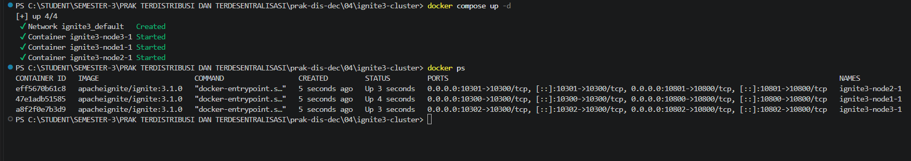

Port utama yang terbuka:
- `10300 - 10302`: REST API administratif / CLI Apache Ignite.
- `10800 - 10802`: Port koneksi aplikasi client.

---

### 4.2.4 Inisialisasi Cluster
Menjalankan CLI Apache Ignite 3 dan melakukan inisialisasi awal cluster pada `node1` (port `10300`).

Perintah yang dijalankan:
```powershell
docker run --rm -it --network=host -e LANG=C.UTF-8 -e LC_ALL=C.UTF-8 apacheignite/ignite:3.1.0 cli
```
Di dalam CLI Apache Ignite:
```text
cluster init --name=ignite3 --metastorage-group=node1,node2,node3
cluster status
```

**Hasil Inisialisasi Cluster Ignite:**
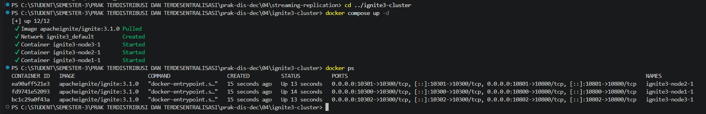

---

### 4.2.5 Eksekusi Perintah-Perintah SQL

#### A. Mounting Folder SQL dan Import Schema
Meng-eksekusi file-file SQL dari direktori lokal ke dalam cluster Ignite melalui node 1 (`http://localhost:10300`).

Perintah penyertaan mount `-v ./sql:/opt/ignite/sql` dan eksekusi skrip:
```text
sql --file=/opt/ignite/sql/schema.sql
sql --file=/opt/ignite/sql/current_catalog.sql
sql --file=/opt/ignite/sql/media_and_genre.sql
sql --file=/opt/ignite/sql/tracks.sql
sql --file=/opt/ignite/sql/ee_and_cust.sql
sql --file=/opt/ignite/sql/invoices.sql
```

**Hasil Eksekusi Import Skrip SQL:**
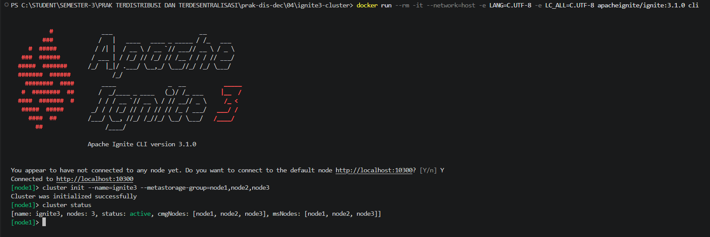

#### B. Memeriksa Propagasi Replikasi ke Node Lain (Node 2 & Node 3)
Koneksi dialihkan ke Node 2 (`http://localhost:10301`) dan Node 3 (`http://localhost:10302`) untuk membuktikan bahwa struktur tabel dan data ter-replikasi penuh secara Master-Master.

1. **Pengujian pada Node 2 (`http://localhost:10301`):**
```text
connect http://localhost:10301
sql
SELECT * FROM system.tables WHERE schema = 'PUBLIC';
```

**Hasil Verifikasi Replikasi pada Node 2:**
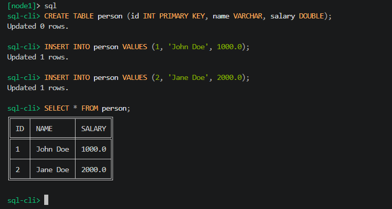

2. **Eksekusi Query Analitis Sales Summary pada Node 3 (`http://localhost:10302`):**
```text
connect http://localhost:10302
sql
SELECT 
    CAST(EXTRACT(YEAR FROM i.InvoiceDate) AS VARCHAR) || '-' ||
    CASE 
        WHEN EXTRACT(MONTH FROM i.InvoiceDate) < 10 THEN '0' || CAST(EXTRACT(MONTH FROM i.InvoiceDate) AS VARCHAR)
        ELSE CAST(EXTRACT(MONTH FROM i.InvoiceDate) AS VARCHAR)
    END AS YearMonth,
    COUNT(DISTINCT i.InvoiceId) AS InvoiceCount,
    COUNT(DISTINCT i.CustomerId) AS CustomerCount,
    SUM(i.Total) AS MonthlyRevenue,
    AVG(i.Total) AS AverageOrderValue
FROM Invoice i
GROUP BY EXTRACT(YEAR FROM i.InvoiceDate), EXTRACT(MONTH FROM i.InvoiceDate)
ORDER BY YearMonth DESC;
```

**Hasil Query Analitis di Node 3:**
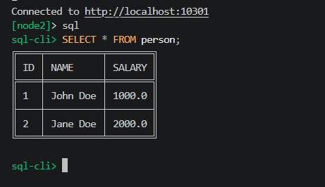

Matikan semua node: 
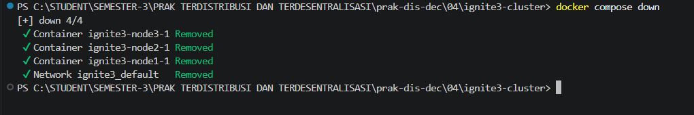

---


 <p align="center">

**Praktikum Pert 4 — Git dan GitHub**

*Sistem Terdistribusi dan Terdesentralisasi*

</p>