# Praktikum Pertemuan 05

## Nama : NEISA PUTRI SYIFAUL QOLBY

## Nim : 255410020

## Kelas : Informatika-1

---

# MODUL 5: FAULT TOLERANCE

# A. TUJUAN

Praktikum ini bertujuan untuk:
1. Memahami penerapan *fault tolerance* pada sistem terdistribusi.
2. Menjalankan beberapa replika aplikasi web menggunakan Docker Compose.
3. Menggunakan Nginx sebagai pintu masuk dan *load balancer* untuk aplikasi.
4. Memahami deteksi kegagalan melalui pemeriksaan ketersediaan layanan.
5. Mempelajari strategi pemulihan komunikasi menggunakan *retry* dan *circuit breaker*.

---

# B. DASAR TEORI

## 1. Fault Tolerance

*Fault tolerance* adalah kemampuan sistem untuk tetap menyediakan layanan ketika sebagian komponennya mengalami gangguan. Salah satu pendekatannya adalah menjalankan beberapa replika layanan dan mendeteksi kegagalan agar permintaan tidak bergantung pada satu proses saja.

## 2. Load Balancing

*Load balancing* membagi atau meneruskan permintaan masuk ke layanan di belakangnya. Pada praktikum ini, aplikasi BlackSheep dijalankan sebagai service `bs_app`, sedangkan Nginx menerima permintaan pada port 80 dan meneruskannya ke aplikasi.

## 3. Failure Detection, Retry, dan Circuit Breaker

*Failure detection* memeriksa apakah layanan dapat dijangkau. Pemeriksaan sederhana dapat dilakukan dengan mencoba membuat koneksi ke alamat dan port layanan. *Retry* mencoba kembali permintaan yang gagal, sedangkan *circuit breaker* menghentikan sementara permintaan setelah sejumlah kegagalan agar layanan yang bermasalah tidak terus-menerus dibebani.

---

# C. PEMBAHASAN

## 4.1 Load Balancing Aplikasi

### 1. Persiapan Environment dan Instalasi BlackSheep

Saya menyiapkan environment Python menggunakan `uv`, kemudian memasang BlackSheep dan CLI-nya untuk membuat aplikasi web.

Perintah yang digunakan:

```powershell
uv venv
.venv\Scripts\Activate.ps1
uv pip install blacksheep blacksheep-cli
```

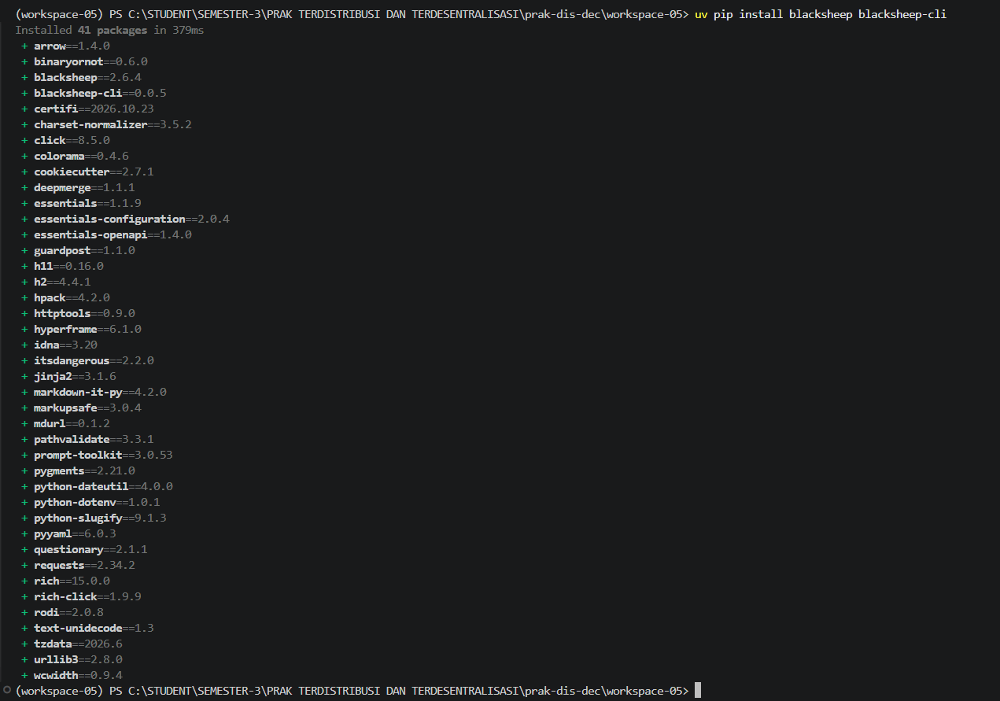

**Penjelasan:**
Terminal menunjukkan proses instalasi dependensi BlackSheep dan `blacksheep-cli` telah selesai. Paket-paket yang diperlukan berhasil dipasang sehingga environment siap digunakan untuk membuat aplikasi.

---

### 2. Membuat dan Menjalankan Aplikasi BlackSheep

Aplikasi dibuat dengan CLI BlackSheep menggunakan nama proyek `blacksheep_lb`. Setelah dependensi proyek dipasang, aplikasi dijalankan untuk memastikan server pengembangan dapat aktif.

Perintah yang digunakan:

```powershell
blacksheep create
cd blacksheep_lb
uv pip install -r requirements.txt
py dev.py
```

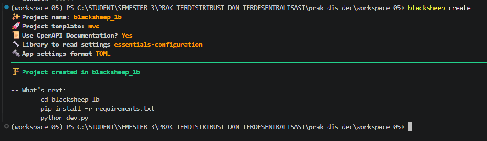

**Penjelasan:**
Output CLI memperlihatkan proyek `blacksheep_lb` berhasil dibuat. Template proyek menggunakan pola MVC dan menyediakan petunjuk untuk masuk ke direktori proyek serta menjalankan server.

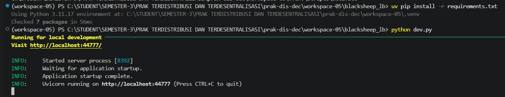

**Penjelasan:**
Dependensi proyek berhasil diperiksa dan server pengembangan berjalan pada `http://localhost:44777`. Pesan *application startup complete* menandakan aplikasi siap menerima permintaan lokal.

---

### 3. Memeriksa Struktur Proyek

Struktur proyek diperiksa sebelum dibuat menjadi image Docker.

Perintah yang digunakan:

```powershell
ls
```

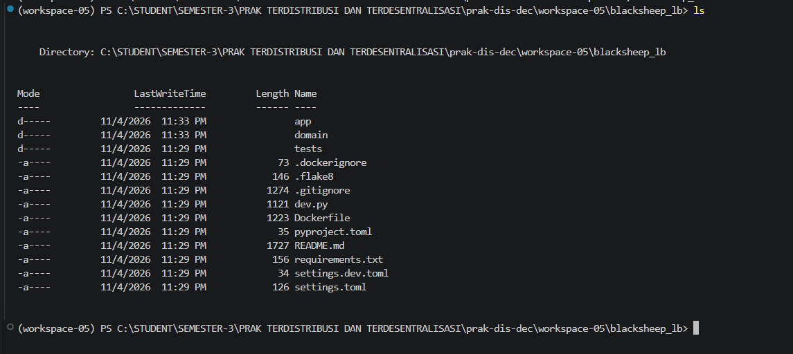

**Penjelasan:**
Tangkapan layar memperlihatkan berkas dan direktori utama aplikasi, seperti `app`, `domain`, `tests`, `dev.py`, `requirements.txt`, serta `Dockerfile`. Struktur ini menjadi konteks build aplikasi pada Docker.

---

### 4. Menyiapkan Dockerfile Aplikasi

Dockerfile digunakan untuk membangun image aplikasi. Konfigurasi pada tangkapan layar menggunakan image Python, memasang dependensi sistem dan Python, membuka port 80, lalu menjalankan aplikasi dengan Uvicorn.

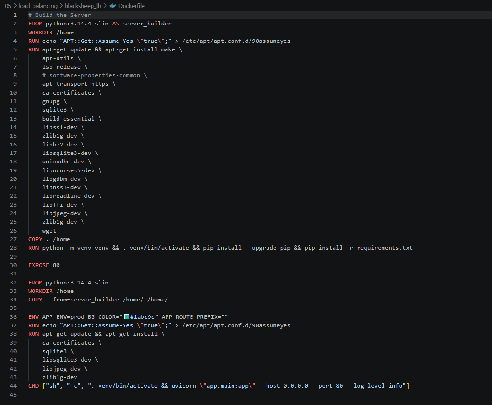

**Penjelasan:**
Dockerfile memisahkan tahap build dependensi dan tahap image aplikasi yang dijalankan. Perintah akhir menjalankan `app.main:app` pada `0.0.0.0:80`, sehingga aplikasi dapat menerima koneksi dari container lain dalam jaringan Docker.

---

### 5. Mengatur Nginx sebagai Reverse Proxy

Nginx dikonfigurasi untuk mendengarkan pada port 80 dan meneruskan permintaan dari lokasi `/` ke upstream `backend`.

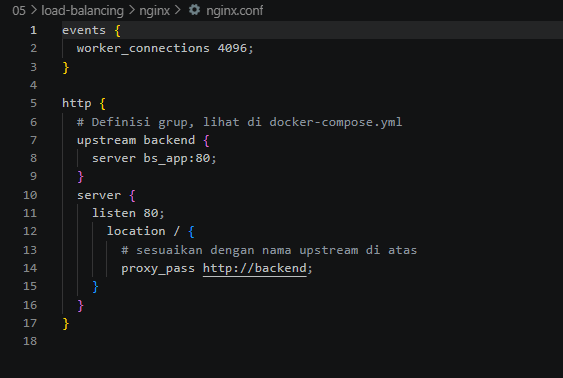

**Penjelasan:**
Blok `upstream backend` mengarah ke service `bs_app` pada port 80. Dengan demikian, klien mengakses Nginx sebagai endpoint depan, bukan mengakses container aplikasi secara langsung.

---

### 6. Build dan Menjalankan Beberapa Replika

Docker Compose digunakan untuk membangun image aplikasi dan Nginx, membuat jaringan, serta menjalankan dua replika `bs_app` bersama container Nginx.

Perintah yang digunakan dari direktori `load-balancing`:

```powershell
docker compose up --build -d --scale bs_app=2
```

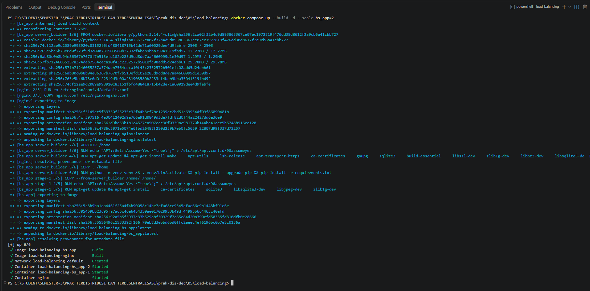

**Penjelasan:**
Proses build selesai dan Docker melaporkan dua container aplikasi (`bs_app-1` dan `bs_app-2`) serta container Nginx telah dimulai. Opsi `--scale bs_app=2` menjalankan dua replika aplikasi.

---

### 7. Mengakses Aplikasi Melalui Nginx

Setelah container aktif, aplikasi diakses melalui alamat lokal.

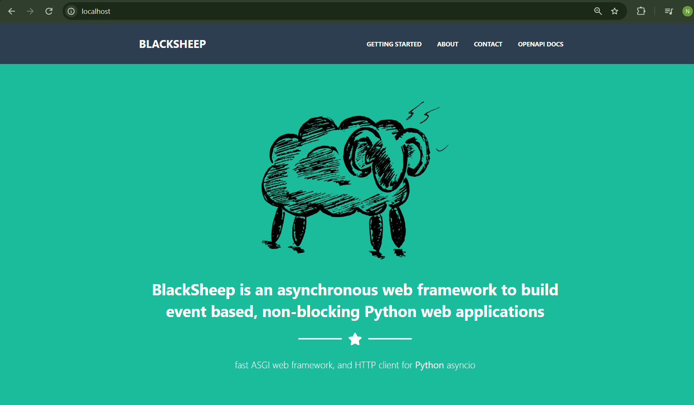

**Penjelasan:**
Halaman utama BlackSheep berhasil ditampilkan melalui `localhost`. Ini menunjukkan endpoint yang dipublikasikan oleh Nginx dapat dijangkau dan permintaan diteruskan ke aplikasi.

---

### 8. Memeriksa Status Container

Status container diperiksa menggunakan perintah berikut:

```powershell
docker ps
```

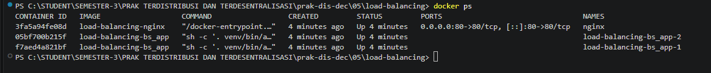

**Penjelasan:**
Output memperlihatkan container Nginx dan kedua replika aplikasi berstatus `Up`. Port host 80 dipetakan ke port 80 pada container Nginx, sehingga klien dapat mengakses layanan melalui `localhost`.

---

### 9. Memeriksa Log Kedua Replika Aplikasi

Log container diperiksa untuk melihat aktivitas aplikasi setelah halaman diakses.

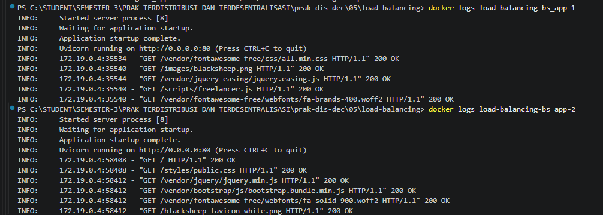

**Penjelasan:**
Log kedua replika menunjukkan proses Uvicorn telah aktif dan permintaan HTTP seperti `GET /` serta permintaan aset mendapat respons `200 OK`. Bukti ini menunjukkan kedua container menerima permintaan selama pengujian. Tangkapan layar ini mendukung pengujian jalur layanan melalui Nginx, tetapi tidak menampilkan metrik atau kebijakan pembagian beban secara langsung.

---

## 4.2 Failure Detection dan Pemulihan Kegagalan

### 10. Pengujian Heartbeat

Pemeriksaan heartbeat dilakukan dengan mencoba menjangkau server pada alamat dan port tertentu. Pada tangkapan layar, perintah yang dijalankan adalah:

```powershell
py check-server.py localhost 44777
```

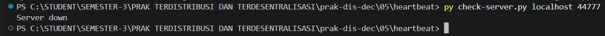

**Penjelasan:**
Skrip menampilkan `Server down` untuk `localhost:44777`, yang berarti layanan pengembangan pada port tersebut tidak dapat dijangkau saat pemeriksaan dilakukan. Hasil ini sesuai jika server lokal yang sebelumnya berjalan pada port 44777 sudah dihentikan. Perlu dibedakan bahwa pada pengujian Docker, endpoint Nginx dipublikasikan pada port 80.

---

### 11. Pengujian Retry dengan Tenacity

Skrip `check-retry.py` menggunakan Tenacity untuk mengulang permintaan HTTP yang gagal karena `ConnectionError`.

Perintah yang digunakan dari direktori `failure-detection`:

```powershell
python check-retry.py
```

Konfigurasi skrip membatasi percobaan hingga lima kali dengan jeda *exponential backoff* antara 4 sampai 10 detik. Jika layanan di `localhost:44777` tidak tersedia setelah seluruh percobaan, skrip menampilkan pesan kegagalan. Karena tidak terdapat screenshot keluaran pengujian retry pada folder bukti, bagian ini menjelaskan perilaku berdasarkan konfigurasi skrip, bukan mengklaim hasil eksekusi tertentu.

---

### 12. Pengujian Circuit Breaker

Skrip `check-circuit-breaker.py` menggunakan pustaka PyBreaker untuk membatasi permintaan ke layanan yang berulang kali gagal.

Perintah yang digunakan dari direktori `failure-detection`:

```powershell
python check-circuit-breaker.py
```

Skrip menetapkan `fail_max=4` dan `reset_timeout=20`, yaitu circuit breaker dirancang terbuka setelah empat kegagalan dan mencoba pulih setelah masa tunggu 20 detik. Karena skrip yang tersedia hanya melakukan satu permintaan dalam satu kali proses dan tidak ada screenshot hasil pengujiannya, bukti yang ada menunjukkan konfigurasi, bukan transisi circuit breaker secara langsung.

---

# D. KESIMPULAN

Berdasarkan praktikum yang telah dilakukan, saya memahami bahwa *fault tolerance* dapat dibangun dengan menggabungkan beberapa pendekatan. Dua replika aplikasi BlackSheep dijalankan menggunakan Docker Compose, sedangkan Nginx menjadi endpoint yang meneruskan permintaan ke service aplikasi. Status container dan log menunjukkan layanan aktif serta permintaan HTTP memperoleh respons berhasil. Pada sisi deteksi kegagalan, heartbeat dapat menunjukkan bahwa server pada port yang diperiksa tidak dapat dijangkau. Tenacity dan PyBreaker menyediakan pola retry dan circuit breaker, meskipun pengujian transisi keduanya belum ditampilkan dalam screenshot yang tersedia.