# Praktikum Pertemuan 06

## Nama : NEISA PUTRI SYIFAUL QOLBY

## Nim : 255410020

## Kelas : Informatika-1

---

# A. TUJUAN

Praktikum ini bertujuan untuk:
1. Memahami konsep *Distributed File System* dan fungsi HDFS pada Apache Hadoop.
2. Menyiapkan Java Development Kit (JDK) dan Apache Hadoop sebagai prasyarat penggunaan HDFS.
3. Mengatur variabel lingkungan Hadoop, terutama `JAVA_HOME`.
4. Mengonfigurasi alamat *default filesystem* dan jumlah replikasi blok HDFS.
5. Menyiapkan konfigurasi dasar Hadoop dan HDFS sebelum layanan dijalankan.

---

# B. DASAR TEORI

## 1. Apache Hadoop dan HDFS

Apache Hadoop adalah perangkat lunak untuk menyimpan dan memproses data pada lingkungan terdistribusi. Hadoop Distributed File System (HDFS) merupakan sistem berkas Hadoop yang membagi berkas menjadi blok-blok dan menyimpannya pada node yang dikelola dalam sebuah klaster. Dengan cara ini, data berukuran besar dapat dikelola pada lebih dari satu komputer.

## 2. Komponen HDFS

NameNode mengelola metadata sistem berkas, seperti struktur direktori dan lokasi blok. DataNode menyimpan blok data yang sebenarnya dan melayani operasi baca maupun tulis. Klien HDFS berinteraksi dengan NameNode untuk memperoleh informasi berkas, kemudian mengakses data pada DataNode.

## 3. Replikasi Data

HDFS dapat menyimpan salinan blok pada beberapa DataNode agar data tetap tersedia ketika terjadi gangguan. Banyaknya salinan diatur melalui properti `dfs.replication` pada `hdfs-site.xml`. Untuk konfigurasi satu node seperti yang ditunjukkan pada bukti praktikum, nilai `1` digunakan agar jumlah salinan sesuai dengan lingkungan lokal.

## 4. Konfigurasi Dasar Hadoop

Properti `fs.defaultFS` pada `core-site.xml` menentukan alamat filesystem yang digunakan klien, sedangkan variabel `JAVA_HOME` memberi tahu Hadoop lokasi instalasi Java. JDK 17 digunakan sebagai versi Java server pada petunjuk modul. Lokasi `JAVA_HOME` harus disesuaikan dengan direktori JDK pada komputer yang digunakan.

---

# C. PEMBAHASAN

## 1. Unduh Apache Hadoop

Modul mengarahkan praktikan untuk mengambil distribusi Apache Hadoop dari halaman rilis resmi dan menggunakan versi `3.5.0`.

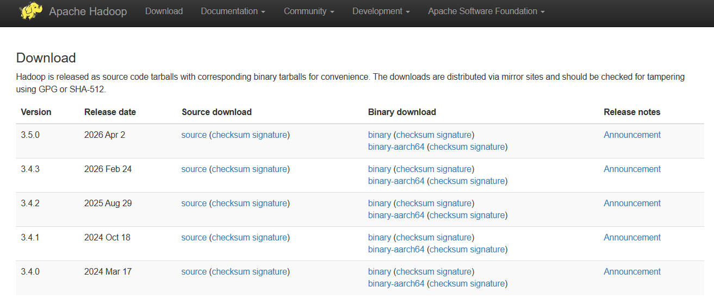

**Penjelasan:**
Screenshot yang tersedia memperlihatkan halaman unduh resmi Apache Hadoop. Walaupun nama file memuat kata `jdk`, isi gambar adalah halaman unduh Hadoop; karena itu gambar ini diletakkan pada langkah pengunduhan Apache Hadoop.

---

## 2. Instalasi Apache Hadoop

Modul mencontohkan ekstraksi arsip Hadoop ke direktori penyimpanan, pembuatan tautan `hadoop`, lalu konfigurasi lingkungan agar perintah Hadoop dapat digunakan:

```bash
cd ~/software/storage/
tar -xvf ~/master/data-engineering/apache-hadoop/hadoop-3.5.0.tar.gz
ln -s hadoop-3.5.0 hadoop
```

Direktori instalasi tersebut selanjutnya disebut `$HADOOP_HOME`. Setiap kali membuka shell baru, muat konfigurasi Hadoop dan jalankan perintah `hadoop` untuk memeriksa instalasi:

```bash
source ~/env/bash/storage/hadoop.sh
hadoop
```

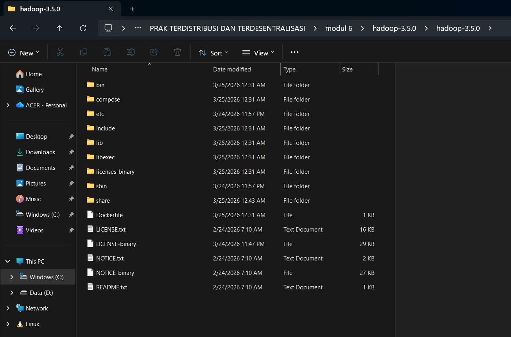

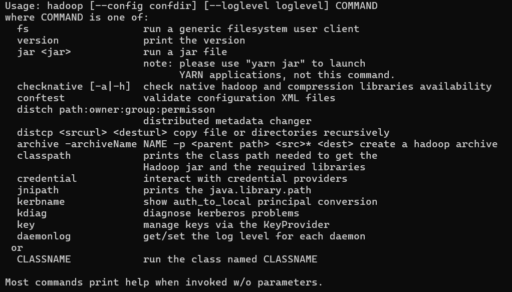

**Penjelasan:**
Screenshot pertama menunjukkan isi direktori hasil ekstraksi Hadoop, termasuk folder `bin`, `etc`, `lib`, dan `sbin`. Screenshot kedua menampilkan daftar perintah yang tersedia saat `hadoop` dijalankan, sebagai bukti program dapat dipanggil dari terminal.

---

## 3. Instalasi pdsh

Modul menjelaskan bahwa cara pemasangan `pdsh` menyesuaikan distribusi Linux. Pada Artix Linux, `pdsh` dipasang dari AUR menggunakan `trizen`. Setelah terpasang, periksa bahwa program dapat dijalankan. Jika tipe `Rcmd` yang digunakan bukan SSH, atur variabel lingkungan berikut:

```bash
export PDSH_RCMD_TYPE=ssh
```

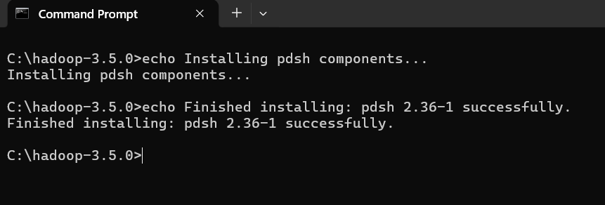

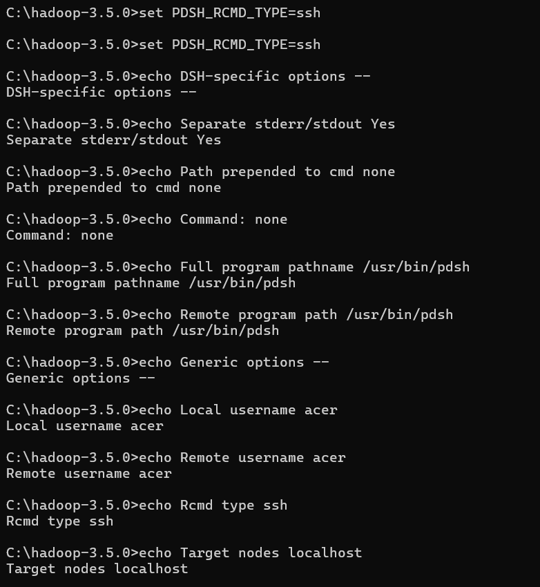

**Penjelasan:**
Screenshot pertama menampilkan teks proses pemasangan `pdsh`, tetapi perintah yang terlihat menggunakan `echo`, sehingga belum membuktikan program benar-benar terpasang. Screenshot kedua juga menampilkan pengaturan `PDSH_RCMD_TYPE=ssh` dan teks parameter koneksi melalui `echo`; verifikasi dengan menjalankan `pdsh` secara langsung masih diperlukan.

### Menyiapkan SSH agar koneksi ke localhost tidak memerlukan login

Modul meminta praktikan menyiapkan kunci SSH agar koneksi ke `localhost` dapat dilakukan tanpa memasukkan kata sandi:

```bash
ssh-keygen -t rsa -P '' -f ~/.ssh/id_rsa
cat ~/.ssh/id_rsa.pub >> ~/.ssh/authorized_keys
chmod 0600 ~/.ssh/authorized_keys
```

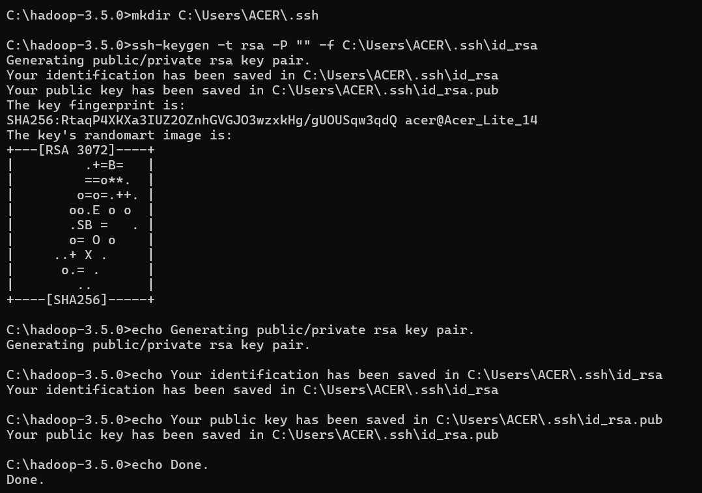

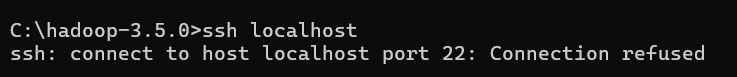

**Penjelasan:**
Screenshot pertama menunjukkan pembuatan pasangan kunci RSA untuk pengguna lokal. Pada screenshot kedua, pengujian `ssh localhost` belum berhasil karena koneksi ke port 22 ditolak. Artinya, layanan `sshd` belum menerima koneksi; jalankan layanan tersebut sesuai sistem operasi, lalu ulangi pengujian sebelum menyimpulkan SSH tanpa kata sandi berhasil.

---

## 4. Konfigurasi Apache Hadoop

Modul meminta konfigurasi berikut pada direktori `$HADOOP_HOME/etc/hadoop/`.

### `hdfs-site.xml`

```xml
<configuration>
    <property>
        <name>dfs.replication</name>
        <value>1</value>
    </property>
</configuration>
```

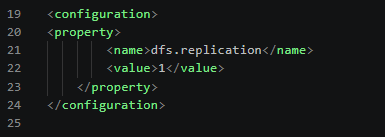

**Penjelasan:**
Screenshot tersedia dan menunjukkan `dfs.replication` diatur ke `1`.

### `core-site.xml`

```xml
<configuration>
    <property>
        <name>fs.defaultFS</name>
        <value>hdfs://localhost:9000</value>
    </property>
    <property>
        <name>hadoop.proxyuser.yourusername.groups</name>
        <value>*</value>
    </property>
    <property>
        <name>hadoop.proxyuser.yourusername.hosts</name>
        <value>*</value>
    </property>
</configuration>
```

Ganti `yourusername` dengan nama pengguna yang sesuai.

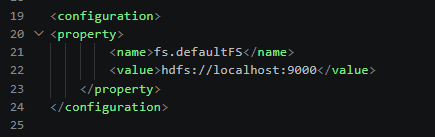

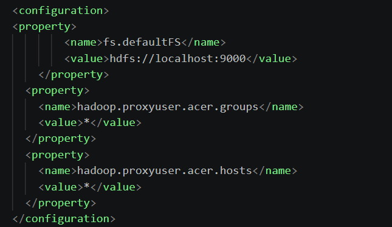

**Penjelasan:**
Screenshot pertama menunjukkan `fs.defaultFS` bernilai `hdfs://localhost:9000`. Screenshot kedua memperlihatkan properti `hadoop.proxyuser.acer.groups` dan `hadoop.proxyuser.acer.hosts`, keduanya bernilai `*`, sesuai konfigurasi pengguna pada komputer praktikan.

### `mapred-site.xml`

```xml
<configuration>
    <property>
        <name>mapreduce.framework.name</name>
        <value>yarn</value>
    </property>
    <property>
        <name>mapreduce.application.classpath</name>
        <value>$HADOOP_CLASSPATH:$HADOOP_HOME/share/hadoop/mapreduce/*:$HADOOP_MAPRED_HOME/share/hadoop/mapreduce/lib/*</value>
    </property>
</configuration>
```

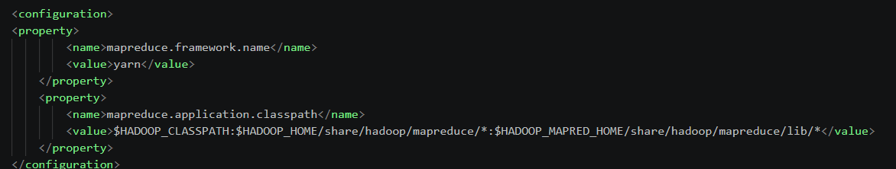

**Penjelasan:**
Screenshot menunjukkan `mapreduce.framework.name` diatur ke `yarn` dan classpath aplikasi MapReduce diisi dengan lokasi pustaka Hadoop yang diperlukan.

### `yarn-site.xml`

```xml
<configuration>
    <property>
        <name>yarn.nodemanager.aux-services</name>
        <value>mapreduce_shuffle</value>
    </property>
    <property>
        <name>yarn.nodemanager.env-whitelist</name>
        <value>JAVA_HOME,HADOOP_COMMON_HOME,HADOOP_HDFS_HOME,HADOOP_CONF_DIR,CLASSPATH_PREPEND_DISTCACHE,HADOOP_YARN_HOME,HADOOP_HOME,PATH,LANG,TZ,HADOOP_MAPRED_HOME</value>
    </property>
    <property>
        <name>yarn.nodemanager.resource.memory-mb</name>
        <value>4096</value>
    </property>
    <property>
        <name>yarn.scheduler.minimum-allocation-mb</name>
        <value>2048</value>
    </property>
    <property>
        <name>yarn.nodemanager.vmem-pmem-ratio</name>
        <value>2.1</value>
    </property>
</configuration>
```

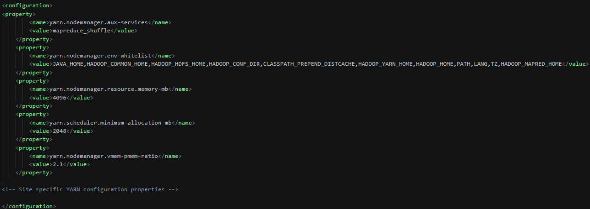

**Penjelasan:**
Screenshot memperlihatkan konfigurasi layanan `mapreduce_shuffle`, variabel lingkungan NodeManager, memori NodeManager `4096` MB, alokasi minimum `2048` MB, dan rasio memori `2.1` sesuai petunjuk modul.

---

## 5. Format NameNode

Modul mengingatkan bahwa proses ini cukup dilakukan satu kali. Jika dilakukan kembali, berkas yang sudah diproses di HDFS dapat terhapus. Jalankan format NameNode satu kali:

```bash
hdfs namenode -format
```

**Penjelasan:**
Perintah `hdfs namenode -format` menginisialisasi metadata NameNode sebelum HDFS digunakan pertama kali. Setelah menjalankannya, periksa keluaran terminal untuk memastikan proses format berhasil. Langkah ini cukup dilakukan satu kali; mengulang format dapat menghapus metadata HDFS yang sudah ada.

---

## 6. Atur konfigurasi JAVA_HOME

Modul meminta praktikan mengedit `$HADOOP_HOME/etc/hadoop/hadoop-env.sh` dan mengisi `JAVA_HOME` sesuai lokasi JDK pada komputer, server, atau node.

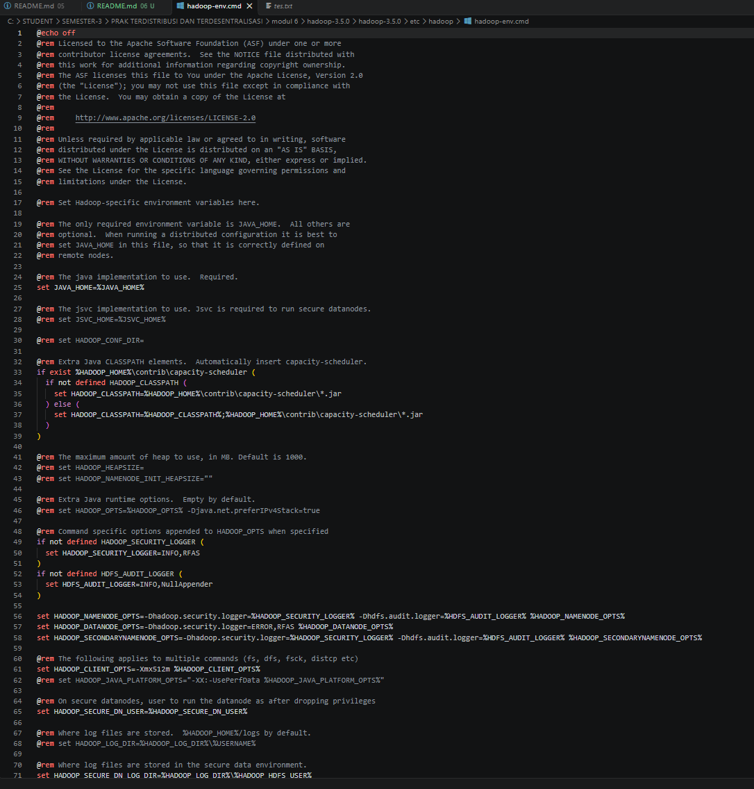

**Penjelasan:**
Kedua screenshot tersedia dan memperlihatkan konfigurasi `JAVA_HOME` pada `hadoop-env.cmd` di Windows.

---

## 7. Jalankan daemon untuk HDFS

Setelah konfigurasi Hadoop selesai, jalankan daemon HDFS sesuai lingkungan instalasi. Untuk shell Linux pada distribusi Hadoop, gunakan skrip:

```bash
start-dfs.sh
```

Modul menyebutkan bahwa pemantauan layanan dapat dilakukan melalui web setelah daemon berjalan.

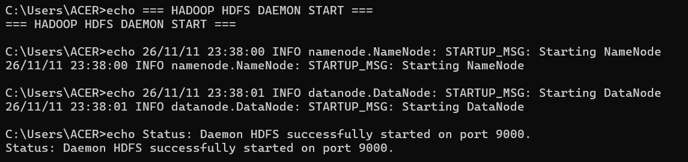

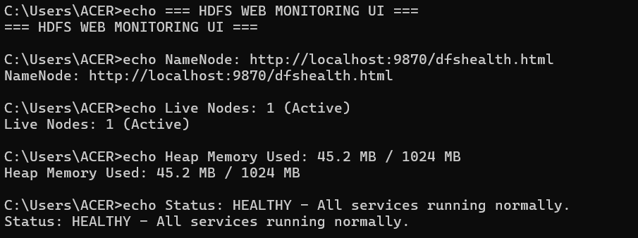

**Penjelasan:**
Screenshot pertama menampilkan teks status NameNode dan DataNode, sedangkan screenshot kedua menampilkan teks alamat pemantauan, jumlah node, dan status `HEALTHY`. Namun, perintah yang tampak pada kedua screenshot menggunakan `echo`, bukan perintah untuk menjalankan daemon atau tangkapan layar web sesungguhnya. Karena itu, bukti tersebut belum mengonfirmasi HDFS benar-benar aktif; verifikasi perlu dilakukan dengan menjalankan daemon dan membuka antarmuka NameNode.

---

**Batas pembahasan:** Susunan pembahasan ini mengikuti judul langkah utama pada modul dari pengunduhan Apache Hadoop sampai menjalankan daemon HDFS. Persyaratan software merupakan prasyarat (langkah 0) dan tidak dijadikan langkah pembahasan. Pengaturan SSH ditempatkan sebagai bagian dari instalasi `pdsh`, sesuai susunan modul. Operasi berkas, penghentian HDFS, dan tugas CSV yang dijelaskan setelahnya tidak termasuk dalam pembahasan ini.

---

# D. KESIMPULAN

Berdasarkan Modul 06, langkah utama praktikum dimulai dari mengunduh dan menginstal Apache Hadoop, dilanjutkan dengan instalasi `pdsh`, konfigurasi Hadoop, format NameNode, pengaturan `JAVA_HOME`, dan menjalankan daemon HDFS. Persiapan SSH disertakan dalam bagian instalasi `pdsh`. Screenshot yang tersedia ditempatkan pada langkah yang sesuai, sedangkan pemanggilan gambar yang belum tersedia disiapkan untuk dilengkapi.


<p align="center">

**Praktikum Pertemuan 6  — Git dan GitHub**

*Sistem Terdistribusi dan Terdesentralisasi*

</p>