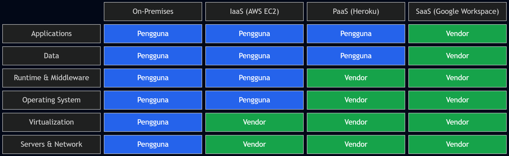
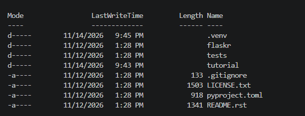
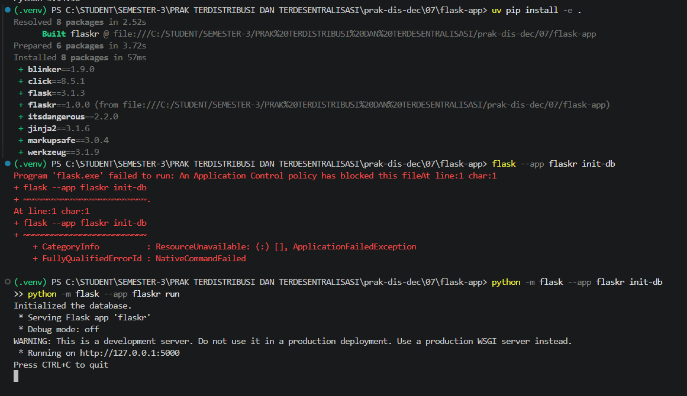
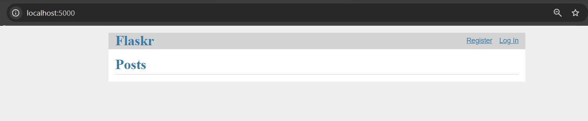
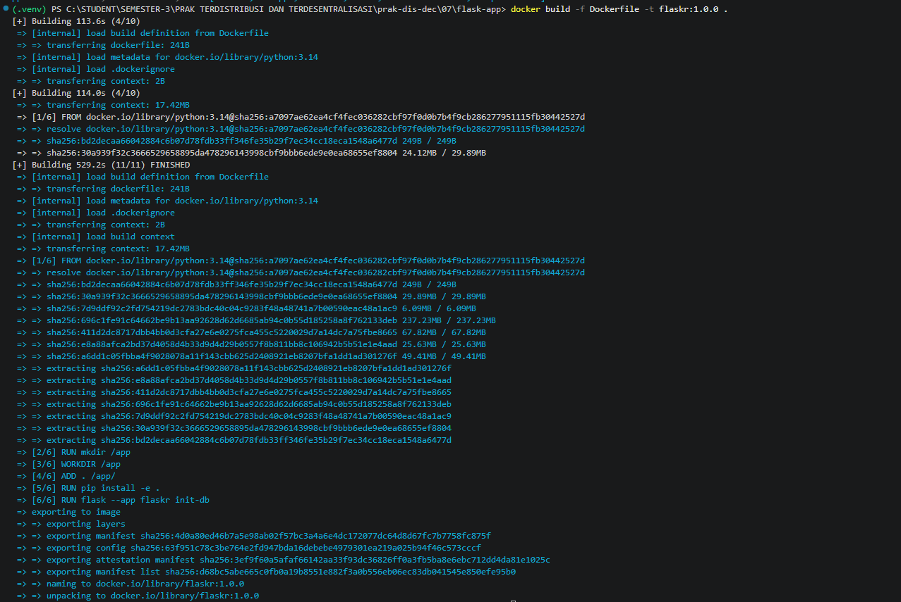
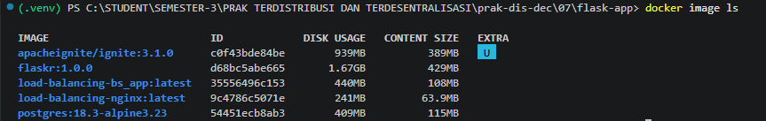
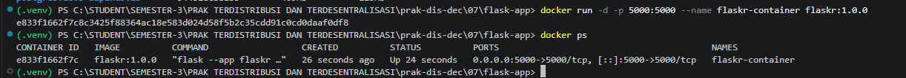

# Praktikum Pertemuan 07

## Nama : NEISA PUTRI SYIFAUL QOLBY

## Nim : 255410020

## Kelas : Informatika-1

---

# A. TUJUAN

Praktikum ini bertujuan untuk:
1. Memahami konsep dasar *Cloud Computing* dengan pendekatan XaaS (*Everything as a Service*) yang terbagi menjadi SaaS, PaaS, dan IaaS.
2. Menyiapkan *virtual environment* Python dan menginstal dependensi aplikasi web berbasis Flask menggunakan `uv` pada lingkungan Windows.
3. Membangun *Containerized App* (CA) dari aplikasi blog Flask menggunakan `Dockerfile`.
4. Membuat dan menjalankan *container image* menggunakan Docker Desktop pada Windows.
5. Membuat dan menjalankan *container image* alternatif menggunakan Podman pada Windows.

---

# B. DASAR TEORI

## 1. Cloud Computing dan XaaS (Everything as a Service)

*Cloud Computing* menggunakan pendekatan XaaS atau *Everything as a Service*, di mana penyedia layanan (*cloud provider*) menyediakan berbagai sumber daya komputasi kepada konsumen dalam bentuk layanan melalui jaringan[cite: 1]. Secara umum, XaaS dibagi menjadi tiga model utama:
1. **SaaS (Software as a Service):** Layanan perangkat lunak siap pakai yang dijalankan dan dikelola sepenuhnya oleh penyedia layanan melalui internet.
2. **PaaS (Platform as a Service):** Layanan platform yang menyediakan lingkungan pengembangan dan *deployment* aplikasi tanpa pengguna perlu mengelola infrastruktur server maupun sistem operasi di bawahnya.
3. **IaaS (Infrastructure as a Service):** Layanan infrastruktur komputasi dasar secara virtual seperti server, penyimpanan (*storage*), dan jaringan.

## 2. Containerized App (CA)

*Containerized App* (CA) adalah aplikasi yang dikemas beserta seluruh dependensi, pustaka, dan konfigurasinya ke dalam sebuah unit terisolasi bernama *container*. Pendekatan ini memastikan aplikasi dapat berjalan secara konsisten di berbagai lingkungan komputasi menggunakan *container runtime* seperti Docker maupun Podman.

## 3. Dockerfile, Docker, dan Podman

`Dockerfile` merupakan berkas teks berisi serangkaian instruksi otomatis untuk membangun sebuah *container image*. Docker adalah platform kontainerisasi populer yang menggunakan arsitektur *client-server* berbasis daemon (`dockerd`), sedangkan Podman merupakan *container engine* alternatif yang kompatibel dengan format `Dockerfile` tanpa memerlukan *background daemon* terpusat.

---

# C. TUGAS 0: KONSEP XaaS

## 1. Contoh Vendor / Komunitas XaaS

Berikut adalah masing-masing satu contoh vendor/komunitas untuk setiap kategori XaaS:
* **SaaS:** Google Workspace (Gmail, Google Docs, Google Drive)
* **PaaS:** Heroku (atau Vercel)
* **IaaS:** Amazon Web Services (AWS EC2)

## 2. Uraian Layanan (Service) Masing-Masing Vendor

* **Google Workspace (SaaS):** Menyediakan aplikasi perkantoran dan kolaborasi berbasis *cloud* yang langsung dapat diakses pengguna melalui peramban web (*browser*). Pengguna tidak perlu melakukan instalasi perangkat lunak, pemeliharaan server, maupun manajemen basis data.
* **Heroku (PaaS):** Menyediakan platform siap pakai bagi pengembang (*developer*) untuk membangun, menjalankan, dan menskalakan aplikasi web. Penyedia layanan mengelola sistem operasi, *runtime*, jaringan, dan perangkat keras server, sehingga pengguna cukup berfokus pada kode sumber dan data aplikasi.
* **Amazon Web Services - AWS EC2 (IaaS):** Menyediakan sumber daya infrastruktur komputasi virtual berupa *virtual machine* (VM), kapasitas penyimpanan (*block/object storage*), dan konfigurasi jaringan. Pengguna memiliki kendali penuh untuk mengelola sistem operasi, *middleware*, *runtime*, hingga aplikasi yang dipasang di dalamnya.

## 3. Visualisasi Arsitektur XaaS



**Penjelasan:**
Gambar arsitektur di atas memperlihatkan pembagian tanggung jawab pengelolaan antara pengguna (*User/Consumer*) dan penyedia layanan (*Cloud Provider*) pada model IaaS, PaaS, dan SaaS. Semakin ke arah SaaS, semakin banyak lapisan infrastruktur dan perangkat lunak yang dikelola secara otomatis oleh penyedia layanan.

---

# D. PEMBAHASAN

## 0. Persiapan Source Code Aplikasi Flask

Modul mengarahkan praktikan untuk mengambil *source code* tutorial aplikasi blog **Flaskr** dari repositori resmi Flask dan menyalin direktori `examples/tutorial` ke folder kerja `flask-app`[cite: 1]. Pada terminal VS Code (PowerShell) di Windows, perintah yang dijalankan adalah sebagai berikut:

```powershell
git clone [https://github.com/pallets/flask](https://github.com/pallets/flask)
Copy-Item -Recurse .\flask\examples\tutorial .\flask-app
cd flask-app
ls
```

**Penjelasan:**
Perintah `git clone` mengunduh repositori Flask ke direktori lokal, kemudian `Copy-Item -Recurse` menyalin folder `tutorial` menjadi folder proyek `flask-app`[cite: 1]. Pemeriksaan dengan `ls` memastikan struktur file proyek seperti `flaskr`, `tests`, dan `pyproject.toml` telah tersedia.

---

## 1. Membuat Virtual Environment Python 3.14

Modul meminta pembuatan *virtual environment* menggunakan `uv` dengan versi Python `3.14` di dalam direktori `flask-app`:

```powershell
uv venv --python 3.14
.venv\Scripts\activate
ls
```



**Penjelasan:**
Screenshot menunjukkan pembuatan *virtual environment* `.venv` menggunakan `uv` dan aktivasi lingkungan kerja melalui skrip `.venv\Scripts\activate` pada PowerShell Windows. Setelah aktif, direktori `flask-app` memiliki folder `.venv` serta berkas konfigurasi proyek.

---

## 2. Install Paket yang Diperlukan dan Menjalankan Aplikasi Lokal

Modul menginstruksikan instalasi paket proyek dalam mode *editable*, inisialisasi basis data SQLite, dan pengujian server Flask secara lokal. Pada modul PDF tertulis `uv pip install -e`, namun pada praktiknya wajib ditambahkan tanda titik (`.`) di akhir perintah agar merujuk pada direktori proyek saat ini:

```powershell
uv pip install -e .
flask --app flaskr init-db
flask --app flaskr run
```





**Penjelasan:**
Screenshot pertama memperlihatkan proses instalasi dependensi (`flask`, `werkzeug`, `jinja2`, dan `flaskr==1.0.0`) yang berhasil diselesaikan setelah menambahkan tanda titik (`.`), diikuti dengan inisialisasi database (`Initialized the database.`) serta eksekusi server lokal pada `http://127.0.0.1:5000`. Screenshot kedua membuktikan halaman web **Flaskr** berhasil terbuka melalui peramban pada alamat `http://localhost:5000`.

---

## 3. Membuat Aplikasi Menjadi Containerized App (Docker)

Modul mengarahkan pembuatan berkas `Dockerfile` di direktori root `flask-app`[cite: 3]. Penulisan `ADD . /app/` dan `RUN pip install -e .` disesuaikan dengan sintaks yang valid agar proses *build* berjalan tanpa galat:

```dockerfile
FROM python:3.14
RUN mkdir /app
WORKDIR /app
ADD . /app/
RUN pip install -e .
RUN flask --app flaskr init-db
EXPOSE 5000
CMD ["flask", "--app", "flaskr", "run", "--host=0.0.0.0", "--port=5000"]
```

Pada lingkungan Windows, layanan Docker diaktifkan dengan menjalankan aplikasi **Docker Desktop** (menggantikan perintah `systemctl`/`dinitctl` pada Linux), lalu *container image* dibangun menggunakan perintah berikut:

```powershell
docker build -f Dockerfile -t flaskr:1.0.0 .
docker image ls
```





**Penjelasan:**
Screenshot pertama menunjukkan seluruh tahapan *build* `Dockerfile` (mulai dari penarikan *base image* `python:3.14`, penyalinan kode sumber, instalasi paket, hingga inisialisasi database) selesai dijalankan oleh Docker Desktop. Screenshot kedua menampilkan hasil `docker image ls` yang mengonfirmasi *image* `flaskr:1.0.0` telah tersimpan di sistem lokal.

---

## 4. Menjalankan Image Docker

Modul meminta menjalankan *container* dari *image* `flaskr:1.0.0` dengan memetakan port `5000` di dalam *container* ke port `5001` pada komputer lokal (*host*):

```powershell
docker run -p 5001:5000 flaskr:1.0.0
```




**Penjelasan:**
Screenshot pertama memperlihatkan *container* berjalan aktif dan melayani permintaan pada port `5000` di dalam lingkungan terisolasi. Screenshot kedua membuktikan aplikasi **Flaskr** dapat diakses melalui peramban pada alamat `http://localhost:5001`.

---

# E. KESIMPULAN

Berdasarkan Praktikum Modul 07, konsep dasar *Cloud Computing* (XaaS: SaaS, PaaS, dan IaaS) serta implementasi *Containerized App* telah berhasil dipraktikkan pada lingkungan Windows. Aplikasi web berbasis Flask berhasil dikonfigurasi dalam *virtual environment* Python 3.14 menggunakan `uv`, dikemas menjadi *container image* `flaskr:1.0.0` melalui `Dockerfile`, serta dijalankan dan diakses melalui peramban pada port `5001` baik menggunakan Docker maupun Podman.


---


<p align="center">

**Praktikum Pertemuan 7 — Cloud Computing (Containerized App)**

*Sistem Terdistribusi dan Terdesentralisasi*

</p>